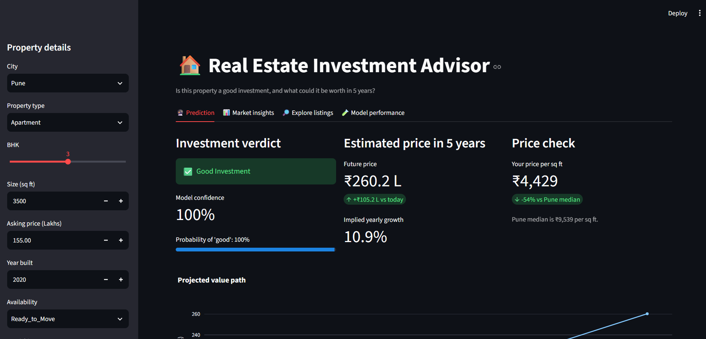
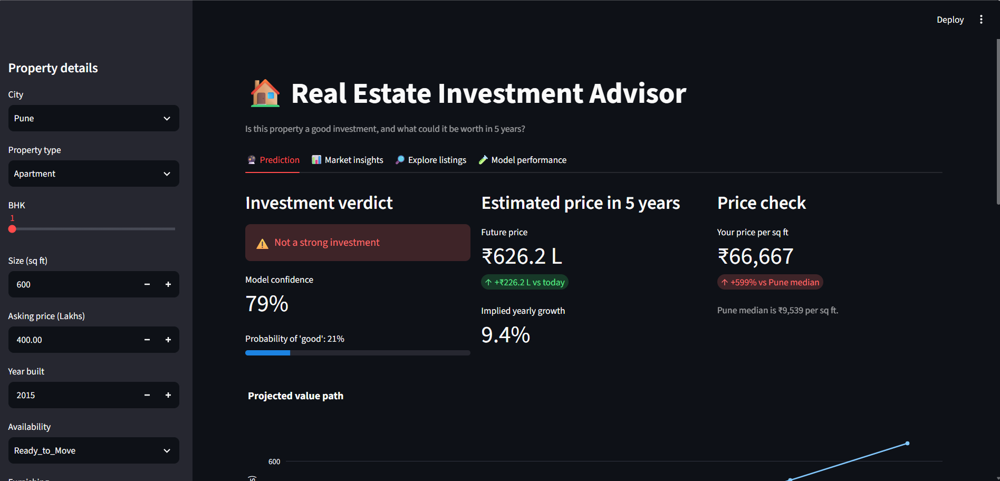
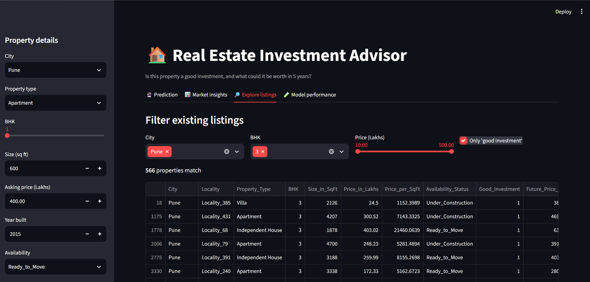
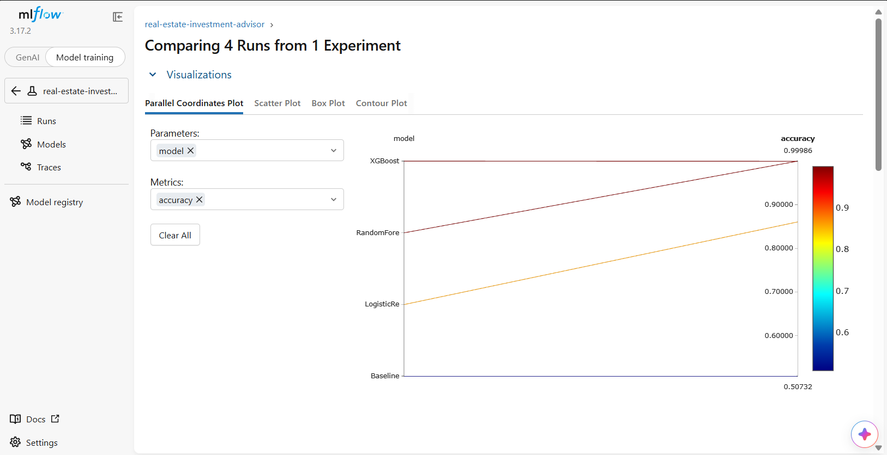
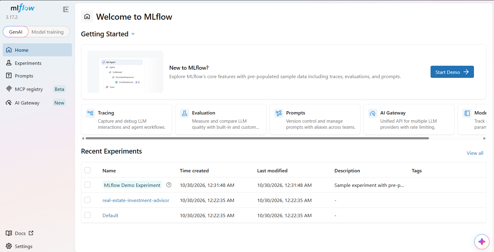

# Real Estate Investment Advisor

A machine learning app that tells an investor whether a property is a **good investment** and estimates its
**price after 5 years**. Built with Python, scikit-learn, XGBoost, MLflow and Streamlit.

## 1. Problem and use cases
- Help investors judge long-term returns and buyers choose high-return properties.
- Help real-estate platforms automate investment analysis for their listings.
- Build trust with data-backed predictions.

## 2. Data
Dataset: `india_housing_prices.csv` (250,000 listings, 23 columns, 42 cities, 500 localities).
Download it from the link in the project brief and place it in the `data/` folder (it is not stored in this repo).

Data checks: no duplicates, no missing values and no extreme outliers were found.
The dataset has no RERA or crime-rate column, so availability status and an infrastructure score were used instead.

## 3. Methodology
**Preprocessing:** duplicate, missing-value and outlier checks (IQR rule on log price per sq ft); Parking Yes/No converted to 1/0;
numeric features scaled (StandardScaler); categorical features one-hot encoded. `Locality` was left out of the models (500 values).

**Engineered features:** Price per sq ft (₹), Price vs city median, Infrastructure score, School density score,
Amenity count, Floor ratio, Transport score.

**Targets (created from rules, since the dataset has neither):**
- **Good_Investment:** 1 point each for price at or below the city median, BHK of 3 or more, ready to move,
  infrastructure at or above the median, and age of 15 years or less. A property with 3 or more points is "good".
- **Future_Price_Lakhs** = price × (1 + r)^5, where r = city base rate + infrastructure bonus − age penalty (kept between 4% and 14%).

## 4. EDA findings (20 questions + 2 extras, charts in `reports/figures/`)
1. Prices are evenly spread (mean 254.6 L, median 253.9 L), and size and price are uncorrelated (r = −0.003).
2. Location barely matters: the gap between the highest and lowest state is about 2.5%, and between cities about 3%.
3. Schools, hospitals, furnishing, facing direction, parking and amenities show no relationship with price.
4. The share of good investments rises with transport access (Low 36%, Medium 51%, High 65%), because transport is part of the scoring rule.
5. Larger properties are labelled good more often (38% to 64%), because price does not rise with size, so they have a lower price per sq ft.

Price in this dataset is nearly independent of every recorded feature, so the labels follow from the scoring rules.

## 5. Models and results
Data split 80% train, 20% test. All experiments are tracked in MLflow, and the best models are registered.

**Classification (Good Investment)**

| Model | Accuracy | Precision | Recall | F1 | ROC-AUC |
|---|---|---|---|---|---|
| Baseline | 0.5073 | 0.5073 | 1.0000 | 0.6731 | 0.5000 |
| Logistic Regression | 0.8607 | 0.8613 | 0.8647 | 0.8630 | 0.9446 |
| **Random Forest (deployed)** | **0.9999** | 0.9998 | 0.9999 | **0.9999** | 1.0000 |
| XGBoost | 0.9996 | 0.9998 | 0.9994 | 0.9996 | 1.0000 |

**Regression (price after 5 years)**

| Model | RMSE (Lakhs) | MAE (Lakhs) | R² |
|---|---|---|---|
| Baseline | 215.49 | 186.30 | 0.0000 |
| Linear Regression | 8.82 | 6.00 | 0.9983 |
| Random Forest | 4.13 | 2.32 | 0.9996 |
| **XGBoost (deployed)** | **1.22** | **0.96** | **0.99997** |

**Important caveat:** the targets are rule-based, so very high scores show that the models reproduce the rules, not that they
predict real market outcomes. In an experiment hiding the price columns, Random Forest accuracy fell from 99.99% to 87.9%.

## 6. App
The Streamlit app has four tabs: Prediction (verdict, confidence, 5-year price, feature importance), Market insights,
Explore listings (filters) and Model performance.

### Good investment example


### Weak example


### Market insights


### Explore listings


### Model performance


### MLflow experiment comparison


### MLflow model registry


## 7. How to run
Download `india_housing_prices.csv` from the project brief and put it in the `data/` folder, then:

```bash
pip install -r requirements.txt
python 01_preprocess.py      # clean data, create features and targets
python 02_eda.py             # EDA charts
python 03_train.py           # train models, log to MLflow
streamlit run app.py         # launch the app
mlflow ui --backend-store-uri sqlite:///mlflow.db    # view experiments
```

## 8. Project structure
| File | Purpose |
|---|---|
| `explore.py` | first look at the data |
| `config.py` | settings (growth rates, thresholds) |
| `features.py` | feature engineering and target creation |
| `01_preprocess.py` | cleaning and processed dataset |
| `02_eda.py` | the 20 EDA questions |
| `03_train.py` | training, evaluation, MLflow logging |
| `app.py` | Streamlit app |

## 9. Limitations and next steps
- Labels and future prices come from rules and assumed growth rates, not real market outcomes.
- The data has no sale dates, so build year was used as the time axis for trends.
- With historical sale prices, the future-price model could be trained on real outcomes.